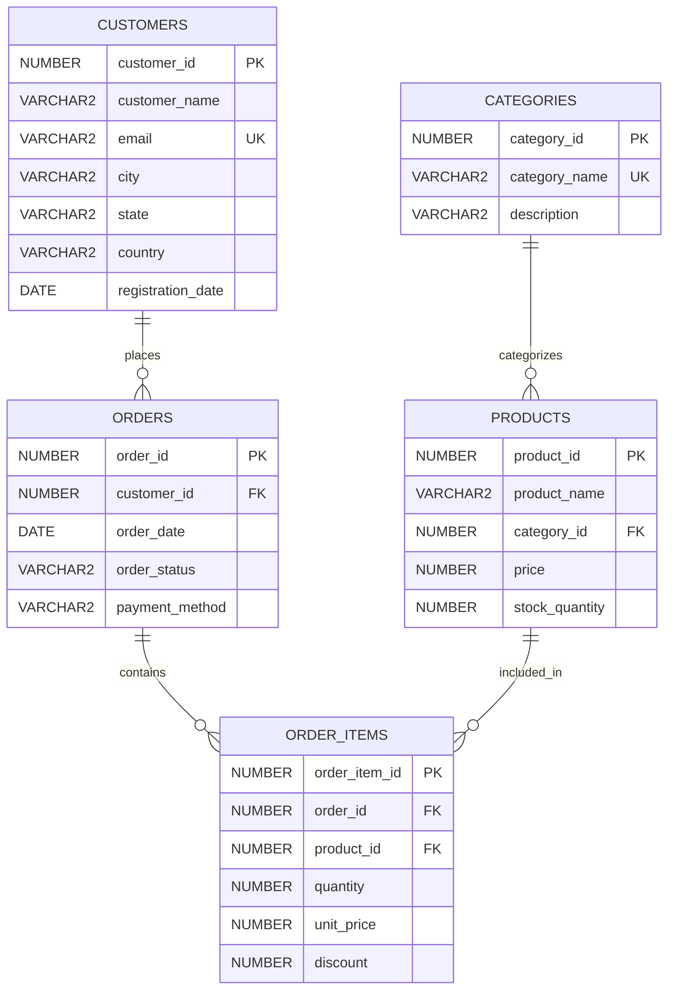

# Online Retail Sales Analytics Dashboard

An industry-level, full-stack Business Intelligence web application that analyzes online retail sales data using advanced Oracle SQL and presents dynamic, interactive executive insights through a modern web dashboard.

---

## 1. Executive Summary & Architecture

The **Online Retail Sales Analytics Dashboard** provides executives, sales directors, and data analysts with real-time operational visibility into e-commerce performance. Built on a decoupled, production-grade architecture:

```
[ Oracle SQL / Relational DB ]
            │ (oracledb / CTEs & Window Functions)
            ▼
[ Python / Flask REST API & Pandas ]
            │ (JSON Endpoints / Dynamic Filtering)
            ▼
[ Modern Responsive Frontend ]
  ├── Bootstrap 5 + FontAwesome 6
  ├── Chart.js 4.4 Data Visualizations
  ├── Real-Time Business Insights Generator
  └── Oracle SQL Analytical Workbench
```

### Key Highlights:
- **Dual-Engine Flexibility**: Seamlessly connects to **Oracle Database 19c/21c/23c/Autonomous Database** via `python-oracledb`, while featuring an automatic zero-config local engine fallback for instant evaluation and testing.
- **Enterprise SQL**: Implements Common Table Expressions (CTEs), Analytic Window Functions (`RANK()`, `DENSE_RANK()`, `ROW_NUMBER()`, `LAG()`, `SUM() OVER ()`), Date Functions, `HAVING`, and `CASE` statements.
- **Real-Time Dynamic Insights Engine**: Formulates dynamic business insights and executive recommendations directly from SQL query results. Never uses hardcoded numbers.

---

## 2. Technology Stack

| Layer | Technology | Details |
|---|---|---|
| **Frontend** | HTML5, CSS3, JavaScript (ES6+) | Modern Blue-and-White Executive BI Theme |
| **UI Framework** | Bootstrap 5.3.3 & FontAwesome 6 | Responsive grid, KPI cards, interactive tables |
| **Data Visualization** | Chart.js 4.4.3 | Dual-axis line & bar, doughnut, and horizontal bar charts |
| **Backend** | Python 3.9+ & Flask 3.0 | Modular Blueprints, CORS, RESTful API architecture |
| **Data Processing** | Pandas 2.2 | Data aggregation, parameter binding, CSV streaming |
| **Database** | Oracle SQL | Standard 3NF schema, indexes, constraints, sequences |

---

## 3. Relational Database Schema

The database consists of 5 normalized relational tables with referential integrity constraints and performance indexes:



### Revenue Calculation Formula:
$$\text{Net Revenue} = \sum (\text{QUANTITY} \times \text{UNIT\_PRICE} - \text{DISCOUNT})$$
*Cancelled orders (`ORDER_STATUS = 'Cancelled'`) are strictly excluded from sales and revenue calculations.*

---

## 4. Analytical Features & Oracle SQL Implementation

### Feature 1: Total Revenue Breakdown
- Calculates total net revenue, revenue by product, revenue by category, and revenue by city.
```sql
SELECT 
    c.CATEGORY_NAME,
    COUNT(DISTINCT o.ORDER_ID)                                  AS ORDER_COUNT,
    SUM(oi.QUANTITY)                                            AS TOTAL_QUANTITY_SOLD,
    ROUND(SUM((oi.QUANTITY * oi.UNIT_PRICE) - oi.DISCOUNT), 2)  AS TOTAL_REVENUE
FROM CATEGORIES c
INNER JOIN PRODUCTS p     ON c.CATEGORY_ID = p.CATEGORY_ID
INNER JOIN ORDER_ITEMS oi ON p.PRODUCT_ID = oi.PRODUCT_ID
INNER JOIN ORDERS o       ON oi.ORDER_ID = o.ORDER_ID
WHERE o.ORDER_STATUS != 'Cancelled'
GROUP BY c.CATEGORY_ID, c.CATEGORY_NAME
ORDER BY TOTAL_REVENUE DESC;
```

### Feature 2: Top 10 Best-Selling Products
- Ranks top 10 merchandise by quantity sold and revenue using `DENSE_RANK() OVER (...)`.
```sql
WITH ProductSalesRank AS (
    SELECT 
        p.PRODUCT_ID,
        p.PRODUCT_NAME,
        c.CATEGORY_NAME,
        p.PRICE,
        p.STOCK_QUANTITY,
        SUM(oi.QUANTITY)                                           AS TOTAL_QUANTITY_SOLD,
        ROUND(SUM((oi.QUANTITY * oi.UNIT_PRICE) - oi.DISCOUNT), 2) AS TOTAL_REVENUE,
        DENSE_RANK() OVER (ORDER BY SUM(oi.QUANTITY) DESC)         AS SALES_RANK_BY_QTY
    FROM PRODUCTS p
    INNER JOIN CATEGORIES c   ON p.CATEGORY_ID = c.CATEGORY_ID
    INNER JOIN ORDER_ITEMS oi ON p.PRODUCT_ID = oi.PRODUCT_ID
    INNER JOIN ORDERS o       ON oi.ORDER_ID = o.ORDER_ID
    WHERE o.ORDER_STATUS != 'Cancelled'
    GROUP BY p.PRODUCT_ID, p.PRODUCT_NAME, c.CATEGORY_NAME, p.PRICE, p.STOCK_QUANTITY
)
SELECT * FROM ProductSalesRank WHERE SALES_RANK_BY_QTY <= 10;
```

### Feature 3: Monthly Sales Analysis & MoM Growth Rate
- Calculates monthly revenue, order volume, Average Order Value (AOV), and Month-over-Month (MoM) growth using `LAG() OVER (...)`.
```sql
WITH MonthlyStats AS (
    SELECT 
        TO_CHAR(o.ORDER_DATE, 'YYYY-MM')                           AS SALES_MONTH,
        TRUNC(o.ORDER_DATE, 'MM')                                  AS MONTH_DATE,
        COUNT(DISTINCT o.ORDER_ID)                                 AS ORDER_COUNT,
        SUM(oi.QUANTITY)                                           AS UNITS_SOLD,
        ROUND(SUM((oi.QUANTITY * oi.UNIT_PRICE) - oi.DISCOUNT), 2) AS MONTHLY_REVENUE
    FROM ORDERS o
    INNER JOIN ORDER_ITEMS oi ON o.ORDER_ID = oi.ORDER_ID
    WHERE o.ORDER_STATUS != 'Cancelled'
    GROUP BY TO_CHAR(o.ORDER_DATE, 'YYYY-MM'), TRUNC(o.ORDER_DATE, 'MM')
)
SELECT 
    SALES_MONTH,
    ORDER_COUNT,
    UNITS_SOLD,
    MONTHLY_REVENUE,
    LAG(MONTHLY_REVENUE, 1) OVER (ORDER BY MONTH_DATE)             AS PREV_MONTH_REV,
    ROUND(((MONTHLY_REVENUE - LAG(MONTHLY_REVENUE, 1) OVER (ORDER BY MONTH_DATE)) / 
           NULLIF(LAG(MONTHLY_REVENUE, 1) OVER (ORDER BY MONTH_DATE), 0)) * 100, 2) AS MOM_GROWTH_PERCENT
FROM MonthlyStats
ORDER BY MONTH_DATE ASC;
```

### Feature 4: Top 10 Customers by Spending
- Ranks VIP customers by lifetime spend and AOV using `DENSE_RANK() OVER (...)` and customer tiers.
```sql
WITH CustSpending AS (
    SELECT 
        c.CUSTOMER_ID,
        c.CUSTOMER_NAME,
        c.EMAIL,
        c.CITY,
        c.STATE,
        COUNT(DISTINCT o.ORDER_ID)                                 AS TOTAL_ORDERS,
        SUM(oi.QUANTITY)                                           AS TOTAL_ITEMS_BOUGHT,
        ROUND(SUM((oi.QUANTITY * oi.UNIT_PRICE) - oi.DISCOUNT), 2) AS TOTAL_SPENDING,
        ROUND(SUM((oi.QUANTITY * oi.UNIT_PRICE) - oi.DISCOUNT) / NULLIF(COUNT(DISTINCT o.ORDER_ID), 0), 2) AS AVERAGE_ORDER_VALUE,
        DENSE_RANK() OVER (ORDER BY SUM((oi.QUANTITY * oi.UNIT_PRICE) - oi.DISCOUNT) DESC) AS SPENDING_RANK
    FROM CUSTOMERS c
    INNER JOIN ORDERS o       ON c.CUSTOMER_ID = o.CUSTOMER_ID
    INNER JOIN ORDER_ITEMS oi ON o.ORDER_ID = oi.ORDER_ID
    WHERE o.ORDER_STATUS != 'Cancelled'
    GROUP BY c.CUSTOMER_ID, c.CUSTOMER_NAME, c.EMAIL, c.CITY, c.STATE
)
SELECT * FROM CustSpending WHERE SPENDING_RANK <= 10;
```

### Feature 5: Product Category Comparison & Market Share %
- Evaluates category performance and calculates market share % using `SUM() OVER ()`.
```sql
WITH CatSales AS (
    SELECT 
        c.CATEGORY_NAME,
        COUNT(DISTINCT p.PRODUCT_ID)                               AS DISTINCT_PRODUCTS,
        COUNT(DISTINCT o.ORDER_ID)                                 AS TOTAL_ORDERS,
        SUM(oi.QUANTITY)                                           AS TOTAL_QUANTITY_SOLD,
        ROUND(SUM((oi.QUANTITY * oi.UNIT_PRICE) - oi.DISCOUNT), 2) AS TOTAL_REVENUE
    FROM CATEGORIES c
    INNER JOIN PRODUCTS p     ON c.CATEGORY_ID = p.CATEGORY_ID
    INNER JOIN ORDER_ITEMS oi ON p.PRODUCT_ID = oi.PRODUCT_ID
    INNER JOIN ORDERS o       ON oi.ORDER_ID = o.ORDER_ID
    WHERE o.ORDER_STATUS != 'Cancelled'
    GROUP BY c.CATEGORY_ID, c.CATEGORY_NAME
)
SELECT 
    CATEGORY_NAME,
    DISTINCT_PRODUCTS,
    TOTAL_ORDERS,
    TOTAL_QUANTITY_SOLD,
    TOTAL_REVENUE,
    ROUND((TOTAL_REVENUE / NULLIF(SUM(TOTAL_REVENUE) OVER (), 0)) * 100, 2) AS REVENUE_SHARE_PERCENT
FROM CatSales
ORDER BY TOTAL_REVENUE DESC;
```

### Feature 6: High-Revenue Cities Ranking
- Identifies metropolitan sales hubs with `DENSE_RANK() OVER (...)` and `HAVING`.
```sql
WITH CitySales AS (
    SELECT 
        cust.CITY,
        cust.STATE,
        COUNT(DISTINCT cust.CUSTOMER_ID)                           AS CUSTOMER_COUNT,
        COUNT(DISTINCT o.ORDER_ID)                                 AS TOTAL_ORDERS,
        SUM(oi.QUANTITY)                                           AS TOTAL_UNITS_SOLD,
        ROUND(SUM((oi.QUANTITY * oi.UNIT_PRICE) - oi.DISCOUNT), 2) AS TOTAL_REVENUE,
        ROUND(SUM((oi.QUANTITY * oi.UNIT_PRICE) - oi.DISCOUNT) / NULLIF(COUNT(DISTINCT o.ORDER_ID), 0), 2) AS AOV_PER_CITY
    FROM CUSTOMERS cust
    INNER JOIN ORDERS o       ON cust.CUSTOMER_ID = o.CUSTOMER_ID
    INNER JOIN ORDER_ITEMS oi ON o.ORDER_ID = oi.ORDER_ID
    WHERE o.ORDER_STATUS != 'Cancelled'
    GROUP BY cust.CITY, cust.STATE
    HAVING COUNT(DISTINCT o.ORDER_ID) >= 1
)
SELECT * FROM CitySales ORDER BY TOTAL_REVENUE DESC;
```

### Feature 7: Business Insights Generator
- Dynamically analyzes actual database results to extract:
  1. **Top Revenue Generating Product** (and exact percentage share of gross sales).
  2. **Peak Sales Month** (and variance compared to the annual monthly average).
  3. **Sales Momentum** (latest month MoM growth/contraction rate).
  4. **Dominant Category & Concentration** (market share percentage).
  5. **Top Metropolitan Market** (highest volume and revenue city).
  6. **VIP Customer Account** (highest lifetime value buyer).
  7. **Inventory Slow-Movers Warning** (products with $\le 6$ units sold).
  8. **Order Cancellation Impact** (unrealized gross dollar loss).
  9. **Strategic Executive Recommendations** (data-driven operational action steps).

---

## 5. REST API Endpoints Specification

| Method | Endpoint | Description | Query Parameters |
|---|---|---|---|
| `GET` | `/api/dashboard` | Main 6 KPI cards summary | `startDate`, `endDate`, `category`, `city`, `status` |
| `GET` | `/api/revenue` | Total revenue, by product, category, city | `startDate`, `endDate`, `category`, `city`, `status` |
| `GET` | `/api/best-selling-products` | Top 10 products + Chart.js payload | `sortBy` (`quantity`\|`revenue`), `limit`, filters |
| `GET` | `/api/monthly-sales` | Monthly sales, peak month, MoM % | `startDate`, `endDate`, `category`, `city`, `status` |
| `GET` | `/api/top-customers` | Top 10 spending customers & VIP tiers | `limit`, filters |
| `GET` | `/api/category-analysis` | Category revenue, quantity, share % | `startDate`, `endDate`, `city`, `status` |
| `GET` | `/api/city-analysis` | City ranking, orders, revenue, AOV | `limit`, filters |
| `GET` | `/api/business-insights` | Dynamic AI/SQL business insights & actions | `startDate`, `endDate`, `category`, `city`, `status` |
| `GET` | `/api/filters` | Distinct dropdown options & date bounds | None |
| `GET` | `/api/sql-queries` | Catalog of Oracle SQL analytical queries | None |
| `GET` | `/api/db-status` | Database engine connectivity status | None |
| `GET` | `/export/csv/<type>` | Direct CSV export of analytical reports | `type`: `products`, `customers`, `monthly`, `categories`, `cities` |

---

## 6. Project Directory Structure

```
online-retail-sales-analytics/
├── app.py                     # Flask application factory & server entry point
├── config.py                  # Environment configuration & DB connection settings
├── requirements.txt           # Python dependencies
├── .env.example               # Template environment variables
├── README.md                  # Comprehensive technical documentation
│
├── database/
│   ├── schema.sql             # Oracle SQL DDL script (tables, constraints, indexes)
│   ├── sample_data.sql        # Oracle SQL DML sample data script (100+ cust, 330 orders)
│   ├── analytics_queries.sql  # Production Oracle SQL analytical queries catalog
│   ├── seed_data.py           # Programmatic dataset generator & seeder
│   └── db_manager.py          # Dual Oracle + SQLite unified connection manager
│
├── routes/
│   ├── dashboard.py           # Dashboard HTML view & CSV export routes
│   └── analytics.py           # REST API analytical endpoints Blueprint
│
├── services/
│   ├── analytics_service.py   # Core analytics calculations & SQL query execution
│   └── insights_service.py    # Dynamic business insights & recommendation engine
│
├── templates/
│   └── index.html             # Responsive Bootstrap 5 BI dashboard template
│
└── static/
    ├── css/
    │   └── style.css          # Executive Blue & White theme stylesheet
    └── js/
        └── dashboard.js       # Chart.js managers, API fetchers, filter state
```

---

## 7. Setup & Installation Guide

### Option A: Instant Quickstart (Zero-Config Local Mode)

The application includes an embedded local engine loaded with the full dataset (105 customers, 56 products, 8 categories, 330 orders, 680+ order items). It runs immediately without needing an active Oracle DB server!

1. **Clone or Navigate to the Project Directory**:
   ```bash
   cd online-retail-sales-analytics
   ```

2. **Create and Activate a Python Virtual Environment**:
   ```bash
   # Windows
   python -m venv venv
   .\venv\Scripts\activate

   # Linux / macOS
   python3 -m venv venv
   source venv/bin/activate
   ```

3. **Install Dependencies**:
   ```bash
   pip install -r requirements.txt
   ```

4. **Start the Flask Application**:
   ```bash
   python app.py
   ```

5. **Open in Browser**:
   Navigate to **`http://localhost:5000`** in your browser.

---

### Option B: Enterprise Oracle Database Setup

To run against an enterprise Oracle Database (Oracle 19c, 21c, 23c, or Oracle Cloud Autonomous Database):

1. **Execute Schema and Data Scripts in Oracle SQL*Plus or SQL Developer**:
   ```sql
   -- Connect as your retail admin user
   @database/schema.sql
   @database/sample_data.sql
   ```

2. **Configure `.env`**:
   Copy `.env.example` to `.env` and fill in your Oracle credentials:
   ```ini
   ORACLE_USER=retail_admin
   ORACLE_PASSWORD=YourPassword123!
   ORACLE_DSN=localhost:1521/XEPDB1
   ```
   *For Oracle Cloud Autonomous Database, provide your wallet directory:*
   ```ini
   ORACLE_WALLET_DIR=/path/to/oracle_wallet
   ORACLE_WALLET_PASSWORD=WalletSecretKey!
   ```

3. **Start Flask**:
   ```bash
   python app.py
   ```
   The application will automatically detect Oracle credentials and execute all analytical queries directly against Oracle DB!

---

## 8. Dashboard User Guide

1. **Executive Overview**: View the 6 real-time KPI cards, monthly revenue/order trend line chart, category revenue share doughnut chart, top products bar chart, and regional cities horizontal bar chart.
2. **Filters & Parameters**: Refine analytical metrics by setting specific date ranges, product categories, customer cities, or order fulfillment statuses. Click **Apply Filters** to dynamically update all views.
3. **Revenue Analysis**: Inspect granular revenue performance grouped across products, categories, and customer cities.
4. **Best-Selling Products**: Toggle between sorting by quantity sold or revenue generated. Monitor low inventory stock warnings.
5. **Monthly Sales Analysis**: Analyze month-over-month growth percentages and easily spot peak revenue months.
6. **Top Customers**: View VIP spending tiers (Platinum, Gold, Silver), lifetime spend, and average basket sizes with instant search.
7. **Business Insights Generator**: Review real-time performance drivers, inventory velocity warnings, and executive recommendations.
8. **Oracle SQL Queries**: Review the complete Oracle SQL query catalog directly from the in-app workbench with syntax highlighting and instant clipboard copying.
9. **Data Export**: Export any analytical dataset directly into CSV format using the dedicated export buttons.
